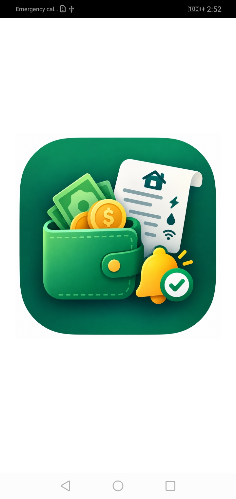
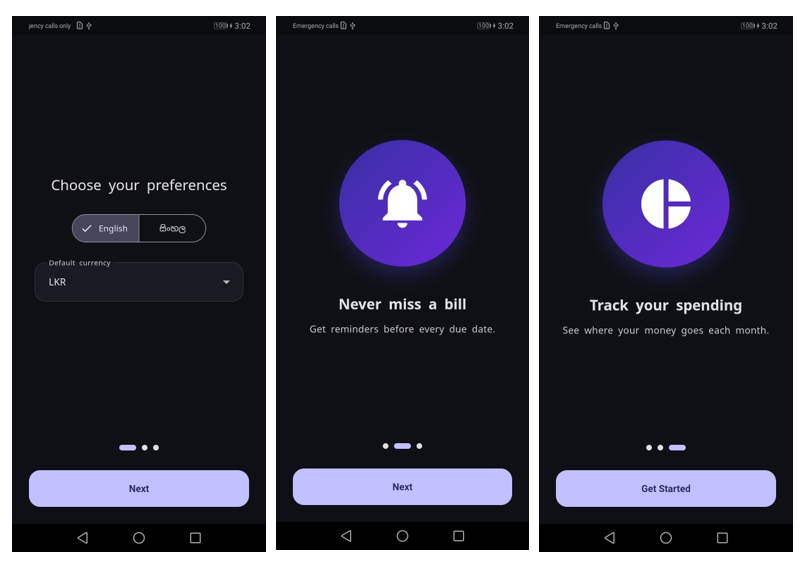
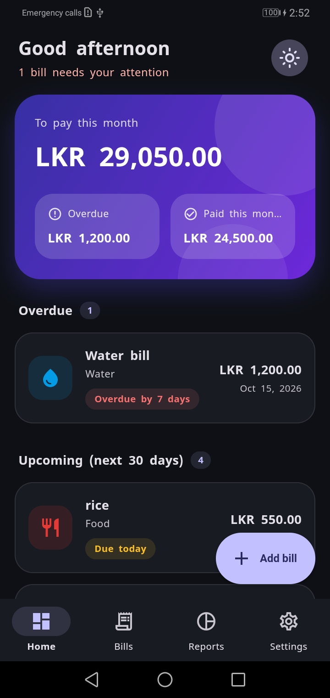
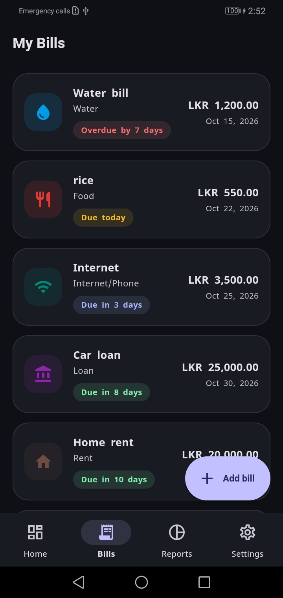
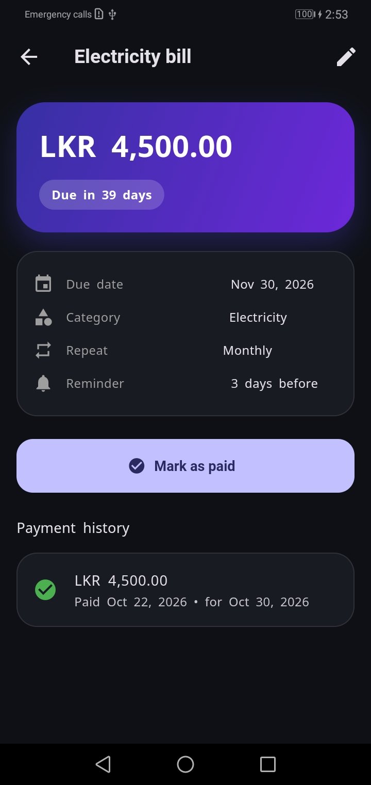
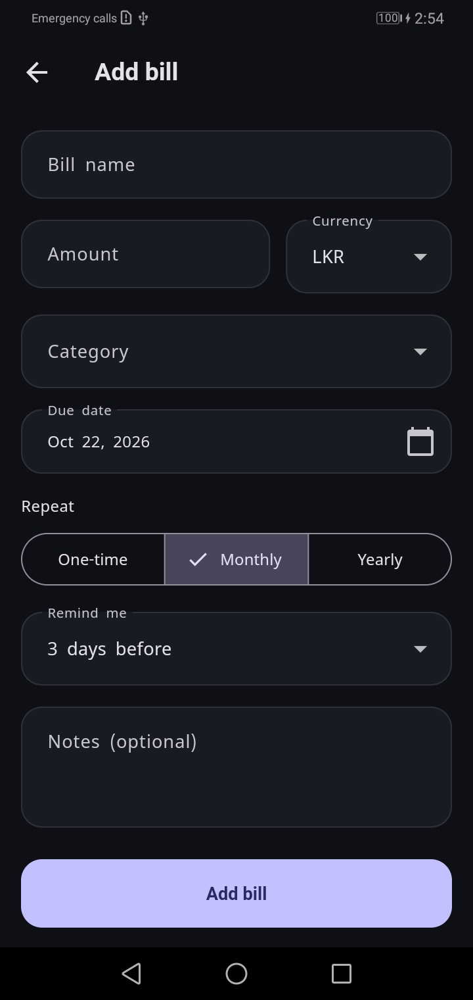
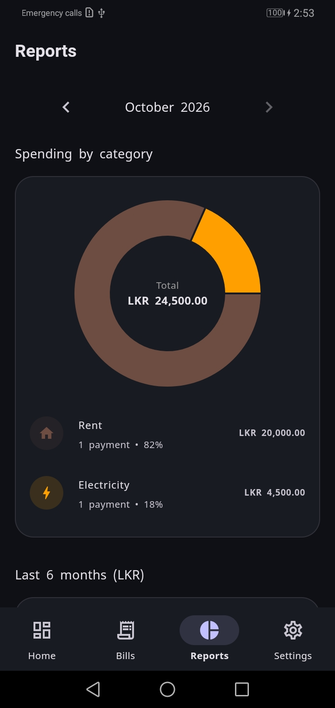
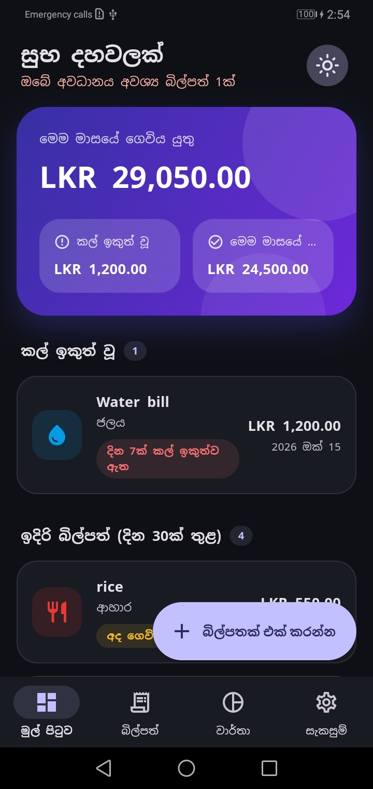
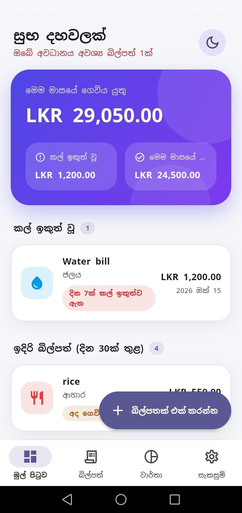

# Smart Budget & Bill Reminder

An offline-first Flutter app that helps you **never miss a bill** and see **where your money goes** each month. Add your electricity, water, loan and other bills, get reminders before they are due, and review your spending in clear charts. Available in **English and Sinhala**, with multi-currency support and no account or internet required.


---

## Why this app

People often forget due dates for electricity, water and loan installments, which leads to late fees and disconnection notices. Most budgeting apps are too complex, English-only, or need an account and internet. This app focuses on two things:

1. **Never miss a bill:** reliable local reminders, even after a phone restart.
2. **See your spending clearly:** simple monthly reports by category and currency.

## Screenshots

>

| Splash | Onboarding | Dashboard |
|:---:|:---:|:---:|
|  |  |  |

| Bills | Bill detail | Add bill |
|:---:|:---:|:---:|
|  |  |  |

| Reports | Sinhala | Dark mode |
|:---:|:---:|:---:|
|  |  |  |

**Demo video:** _https://youtube.com/shorts/X49MTqbcBFM_

## Features

**Bills**
- Add, edit and delete bills with a name, amount, currency, category, due date, repeat option and notes
- Repeat options: one-time, monthly or yearly
- **Mark as paid** with the actual amount paid; the next due date is generated automatically for recurring bills
- Full payment history for every bill
- Swipe to delete with confirmation

**Reminders**
- Local notifications: an advance reminder (same day, 1, 3 or 7 days before), a due-day reminder, and an overdue nudge
- Configurable reminder time
- Tapping a notification opens that bill
- Reminders are restored after a phone restart and rebuilt automatically after every change

**Dashboard and reports**
- Dashboard with a gradient summary card: to pay this month, overdue, and paid this month
- Colour-coded status chips (overdue, due soon, upcoming)
- Donut chart of spending by category for the selected month
- Bar chart of the last 6 months
- Month selector and currency selector

**Multi-currency**
- Each bill has its own currency (LKR, USD, EUR, GBP, INR, AUD, CAD, AED, SGD, JPY)
- Totals and charts are always grouped per currency, so different currencies are never mixed

**Language and appearance**
- Full **Sinhala / English** support: interface, dates, month names, category names and notification text
- Starts in Sinhala automatically on a Sinhala phone
- Light, dark and system themes
- Animated splash screen and a first-launch onboarding flow

**Privacy by design**
- 100% offline: all data stays on the device
- No account, no analytics, no internet permission

## Tech stack

| Concern | Choice |
|---|---|
| Framework | Flutter (Dart) |
| State management | Riverpod (`flutter_riverpod`) |
| Navigation | `go_router` |
| Local database | SQLite via `sqflite` |
| Settings storage | `shared_preferences` |
| Notifications | `flutter_local_notifications`, `timezone`, `flutter_timezone` |
| Charts | `fl_chart` |
| Localization | `flutter_localizations`, `intl`, ARB files (`en`, `si`) |
| Native splash and icon | `flutter_native_splash`, `flutter_launcher_icons` |
| Testing | `flutter_test` |

## Architecture

A feature-first structure with simple layers:

```
UI (screens and widgets)
   -> Riverpod providers (state)
      -> Repositories (all SQL lives here)
         -> SQLite database
```

`NotificationService` reads the bills from the database and rebuilds all reminders whenever bills, the reminder time or the language change.

```
lib/
  core/
    constants/        app constants and preference keys
    localization/     locale provider, l10n helpers
    router/           go_router configuration
    services/         notification service
    theme/            colours, light/dark themes, theme mode provider
    utils/            helpers (money, dates), recurrence logic
    widgets/          reusable UI pieces (chips, empty state, animations)
  data/
    database/         SQLite helper, debug sample-data seeder
    models/           Bill, Category, Payment
    repositories/     bill, category, payment, report repositories
  features/
    splash/           animated splash
    onboarding/       language, currency, intro slides
    shell/            bottom navigation
    dashboard/        summary card, greeting, upcoming and overdue lists
    bills/            list, detail, add/edit, providers, bill card
    reports/          charts and providers
    settings/         language, currency, theme, reminder time
  l10n/               app_en.arb, app_si.arb (+ generated localizations)
  main.dart
test/                 unit tests
```

### Database schema

| Table | Key fields |
|---|---|
| `categories` | id, name_en, name_si, icon, color |
| `bills` | id, title, amount, currency, category_id, due_date, recurrence, reminder_days, notes, is_active, anchor_day |
| `payments` | id, bill_id, amount_paid, currency, paid_date, due_date_covered |

Monthly reports come from SQL `GROUP BY` queries on `payments` joined with `bills` and `categories`. Deleting a bill cascades to its payments. The schema is versioned (`onUpgrade`) so existing installs migrate without losing data.

## Technical highlights

- **Month-end recurrence:** a bill due on the 31st goes to Feb 28 (or 29 in a leap year) and then returns to Mar 31. Each bill stores its original *anchor day*, so the date never drifts.
- **Atomic payments:** marking a bill as paid records the payment and moves the due date in a single database transaction, so the two can never get out of sync.
- **Per-currency aggregation:** all totals and charts are computed per currency, avoiding wrong sums without any exchange-rate service.
- **Reliable reminders:** timezone-aware scheduling, restored after reboot, and rebuilt on every change. Inexact scheduling is used on purpose, so no exact-alarm permission is needed.
- **Daylight-saving safe dates:** day differences use UTC dates, so a bill never shows "due today" a day early in countries with daylight saving.
- **Localization beyond UI text:** notification text, dates, number formats and category names all follow the chosen language, and the language can be switched at runtime.
- **Tested logic:** unit tests cover the recurrence and month-end rules and the dashboard totals.

## Getting started

### Prerequisites

- Flutter 3.38.1 or newer (stable) and the Android toolchain
- An Android device or emulator (Android 7.0 / API 24 or higher)

### Run the app

```bash
git clone https://github.com/ChamodyaIshani99/smart_budget.git
cd smart_budget

flutter pub get
flutter gen-l10n      # generates the localization classes from the .arb files
flutter run
```

Optional: for the best Sinhala rendering on every phone, add the **Noto Sans Sinhala** font files to `assets/fonts/` and register them in `pubspec.yaml`. The app falls back to the phone's own font if they are missing.

### Run the tests

```bash
flutter analyze
flutter test
```

### Debug sample data

In debug builds, **Settings > Developer** has buttons to add and remove sample payments, which is handy for trying the charts. To show them in a release build for a demo:

```bash
flutter run --release --dart-define=DEMO=true
```

### Build a release

1. Create an upload keystore and an `android/key.properties` file (neither is committed to Git).
2. Build the app bundle:

```bash
flutter build appbundle
```

The output is `build/app/outputs/bundle/release/app.aab`.

## Roadmap

- [ ] Export and backup (CSV / PDF)
- [ ] App lock (PIN / biometrics)
- [ ] Custom categories
- [ ] Monthly budget limits with warnings
- [ ] Home screen widget for the next due bill
- [ ] Optional exchange rates for combined totals

## Privacy

Smart Budget works entirely on your device. It does not collect, transmit or share any personal data, and it does not request internet access.

## Author

**Ishani Chamodya**
- LinkedIn: [linkedin.com/in/chamodya10](https://linkedin.com/in/chamodya10/)
- GitHub: [@ChamodyaIshani99](https://github.com/ChamodyaIshani99)
